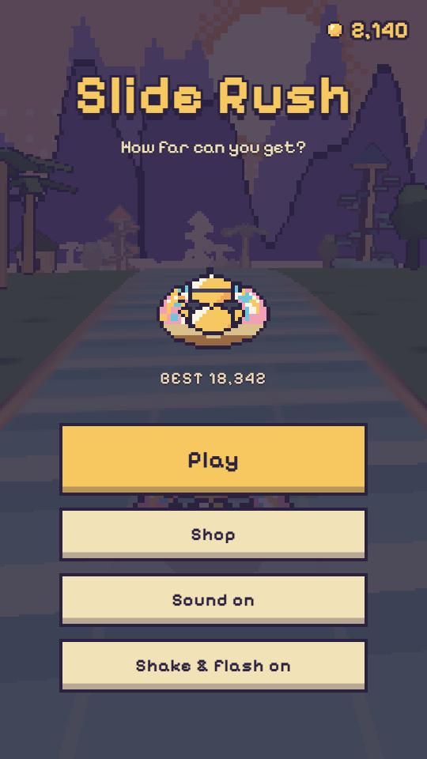
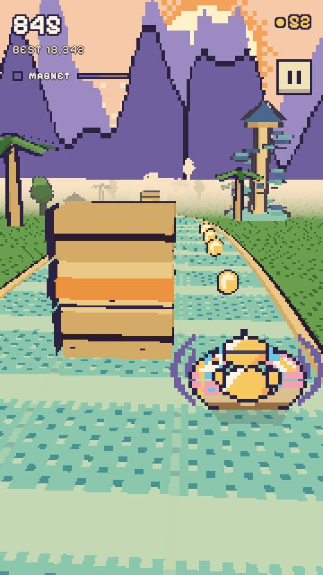
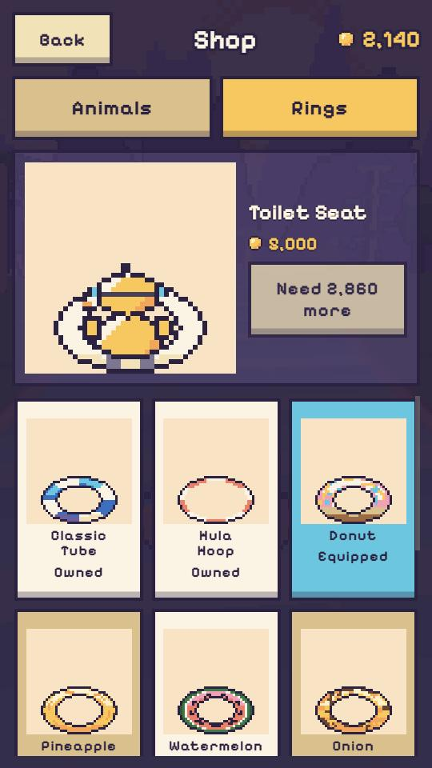

# Slide Rush

*Created by **Sagi G Haim (SaG)**.*

An endless runner set on a water-park slide, in the spirit of Subway Surfers. Ride an animal in a funny ring, switch between 3 lanes, jump over mines, duck under arches, grab coins and power-ups, and see how far you get. Then spend the coins in the shop on a new animal or ring.

<p>
  
  
  
</p>

**Status:** `v0.2.1` — retro pixel art, 6 animals × 11 rings, and a shop to spend coins in. `v0.2.0` was released after Sagi played it and approved it; `v0.2.1` adds the game-over line that says how close the next shop item is, and the creator credit; the [QA checklist](docs/QA-v0.2.md) is there for the next round. `v0.1.0` was the MVP, checked on phones (Chrome and Safari).

> Hit feedback: the phone vibrates on a trip or a crash where the browser
> allows it. Safari on iOS has never supported the Vibration API, and every
> browser on an iPhone is Safari underneath, so iPhones get the screen flash
> and the camera shake instead.

**Play it:** https://sagi0011-svg.github.io/slide-rush/

- Platform: browser, mobile-first (portrait), keyboard supported on desktop
- Stack: Three.js + TypeScript + Vite, Vitest for tests
- Hosting: GitHub Pages (auto-deploy from `main`)

## Docs

- [Game spec](docs/SPEC.md) — what the game is, every rule and number
- [Art, riders and shop](docs/ART-AND-SHOP.md) — the v0.2 plan: the pixel look, the animals and rings, prices
- [v0.2 phone QA checklist](docs/QA-v0.2.md) — what to check on a phone before tagging `v0.2.0` (Hebrew)
- [Milestones](docs/MILESTONES.md) — build order, with a ready prompt per milestone
- [CLAUDE.md](CLAUDE.md) — working rules for Claude Code in this repo
- [Assets](ASSETS.md) — where every sound and visual comes from, and its licence

## Controls

| Action | Touch | Keyboard |
|---|---|---|
| Change lane | Swipe left / right | ← / → or A / D |
| Jump | Swipe up | ↑ / W / Space |
| Slide (duck) | Swipe down | ↓ / S |
| Pause | Pause button | Esc / P |
| Leave the shop | Back button, or the phone's back gesture | Esc |

## Development

```bash
npm install
npm run dev              # local dev server at http://localhost:5173/slide-rush/
npm run dev -- --host    # same, but reachable from your phone on the same Wi-Fi
npm test                 # unit tests
npm run lint             # eslint + prettier + typecheck
npm run build            # production build into dist/
npm run preview          # serve the production build locally
```

### Debug flags

| Flag | What it does |
|---|---|
| `?debug=1` | Debug panel: fps and the slowest frame, draw calls, resolution, speed, tier, seed and more, plus sliders and switches |
| `?seed=123` | Forces the run seed, so a run can be reproduced exactly |
| `?debug=1&gallery=1` | Rider gallery: every animal in every ring, in every pose, instead of the game |
| `1` `2` `3` | With `?debug=1`: grants shield, magnet and speed boost |
| `I` | With `?debug=1`: invincibility on/off (obstacles are passed straight through) |
| `H` | With `?debug=1`: hitbox outlines on/off (green player, red deadly, yellow trips) |

The panel also has a **speed** slider (x0.25 to x2) and a **tier** slider (auto, or hold any difficulty tier). Both stay set across restarts until the page is reloaded. Tap **controls** to fold the panel away.

### Deployment

Every push to `main` runs lint, tests and build in GitHub Actions, then publishes
`dist/` to GitHub Pages. The Vite `base` is `/slide-rush/`, matching the Pages URL.
